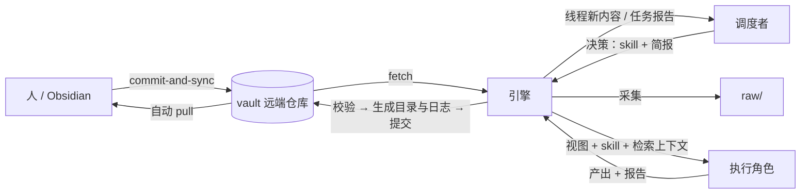

# work_sheet 设计文档

状态：第四稿（2026-11-14）。在 M0–M2 可运行的基础上，依据对近半年同类实践的调研重新组织：操作流程从角色提示词移进 skill，目录、日志和检索上下文改由引擎生成，并补上"整理""综述""简报"三类操作。需求以 [user-stories.md](user-stories.md) 为准；第 19 节是故事对照表，第 20 节是调研来源与取舍。

## 1. 定位

一个人和一组 agent 共同维护的 Obsidian 知识库。人只做三件事：在 `inbox/` 里用自己的话提要求、给材料、看结果。系统要做到三点，整个设计围绕它们展开：

| 目标 | 含义 | 对应章节 |
|---|---|---|
| **找得到** | 人和 agent 都能快速、可靠地找到要的内容 | 第 6 节 |
| **融得进** | 新知识无缝并入已有知识：不重复、有链接、矛盾留痕、旧说法被更新 | 第 7 节 |
| **说得出** | 知识能流畅地流出来：答案、汇报、综述、简报，都有出处 | 第 8 节 |

支撑它们的是一个小型 harness（第 4、9–14 节）：确定性的引擎、一个便宜的调度者、四个权限不同的执行角色、十一个操作 skill。服务的工作流是两条：知识积累（K 类故事）和项目跟进（P 类故事）。

不做：Web UI、多机协同、后台常驻、操作系统级沙箱、向量检索、PPT 等二进制格式的导出（第 18 节说明何时再做）。

## 2. 设计原则

每条都来自调研里反复出现的经验（出处见第 20 节），后文的具体设计是它们的展开。

1. **程序能做的，不交给模型。** 目录、日志、检索候选、校验、去重判断都由引擎完成。凡是让模型手工维护汇总文件的实现，都报告过更新丢失和内容漂移。
2. **角色管权限，skill 管流程。** 角色只按"能看什么、能写什么、用什么模型"划分；怎么做一件事写在 skill 里。按职能切分 agent 会造成层层转述的失真，单个 agent 加 skill 往往更好——所以角色保持最少。
3. **先找再写，能更新就不新建。** 重复页是这类知识库的默认失败方式。写之前由引擎给出相关的已有页面和全部页面名，新建页面有门槛。
4. **不悄悄覆盖。** 分歧并列写出，被更新的说法留痕，人拥有的文档只提建议。
5. **只依据记录表达。** 输出的每个论断带出处；查不到就说没有。
6. **必须成立的约束写成代码。** 提示词里的规定只是建议；写入范围、命名冲突、必填字段、只追加的日志都在导入时机械检查，不通过则整个任务作废。
7. **状态在仓库里。** 任务、知识、项目记录全是 vault 里的 Markdown；引擎本机只有一份 clone 和日志，随时可以重建。

## 3. 交互模型

1. 人在 `inbox/` 新建一页，用自然语言写要求，材料以 URL、拖入的附件或本机路径给出。不需要写 `@`，也不需要知道有哪些角色和 skill。
2. 人执行 obsidian-git 的 "Commit-and-sync"。**提交即发送。**
3. 系统在该页追加**任务块**，并随进度原地更新：

```markdown
> [!task] [[T-20261114-001]] · librarian · done
> 摘要……
>
> 新建：[[wiki/concepts/Kelly Criterion|Kelly Criterion]]
> 修改：[[wiki/concepts/Sharpe Ratio|Sharpe Ratio]]
```

4. 人在任务块下面继续写追问、修改意见或回答，再同步。**一页 inbox 就是一个线程。**
5. 系统需要澄清时任务进入 `blocked`，问题写在任务块里。
6. 首页 `Home.md` 汇总等人处理的事项、项目状态和最近收录；看板可以拖卡片取消或重跑。

## 4. 架构

| 组成 | 职责 |
|---|---|
| **引擎**（本项目代码） | 唯一执行 git、唯一写任务状态；采集材料；生成目录、日志和检索上下文；构造隔离视图；校验并导入产出。全部是确定性代码 |
| **调度者** | 小模型。读线程里的新内容和任务报告，输出决策：采集什么、登记哪些任务、各用哪个 skill、简报怎么写 |
| **执行角色** | 强模型。每个任务一次全新运行，只看到被授权的文件，按 skill 干活 |
| **skill** | 一种操作的规程：步骤、判断标准、输出格式、检查清单、常见错误 |
| **任务笔记** | `tasks/T-*.md`，任务状态的唯一事实来源 |



### 一轮巡检（`worksheet tick`）

1. 同步 clone 到远端最新。
2. **补齐与再生成**：把 `vault-template/` 里 vault 尚缺的文件补上；按当前页面的 frontmatter 重新生成各目录。
3. **状态校正**：发现有任务处于 `running`（上次中断或被手动改动）标为 `failed`；任务块显示的状态与任务笔记不一致时以任务笔记为准。
4. **调度线程**：找出有新内容的 inbox 页，逐个交给调度者，执行决策（采集、建任务笔记、写任务块）。
5. **循环**直到没有新任务：调度带有后续建议的任务报告 → 运行所有 `ready` 的任务。一条多步链在一次巡检里走完。
6. 每个任务：改 `running` → 构造视图 → 启动 runner → 校验 → 导入 → 生成目录、追加日志 → 更新任务块 → 提交推送。

## 5. vault 结构

```
Home.md                首页：用法、等我处理、项目、最近收录
inbox/                 人的入口，一页一个线程；attachments/ 是附件目录
raw/YYYY/MM/<日期>-<slug>/   原始来源存档，只增不改：source.md（带 sha256）+ 原件
wiki/                  外部知识，librarian 维护
  sources/  concepts/  entities/
  topics.md            主题表（受控词表）
  index.md  */_index.md  log.md      引擎生成，任何角色都不能改
practice/              "我们的做法"，归人所有
proposals/             对 practice/ 的修改建议
projects/
  _index.md            项目名册，引擎生成
  <项目>/status.md  log.md  decisions/  reports/
outputs/               不属于某个项目的交付物：答案、综述；digests/ 是阶段简报
briefings/<简报名>/YYYY/MM/   外部流水线产出的日报、周报，引擎导入，只读
work/<任务 id>/        角色的过程文档（researcher 的搜集记录）
tasks/                 任务笔记；board.base 是看板
views/                 首页用到的 Bases 视图
assets/                图片
```

目录表示内容种类和**所有权**；进度只由任务笔记的 `status` 表示。`vault-template/` 是这套骨架的样板，新 vault 第一次巡检时自动铺开，以后新增的视图也靠它下发（只补缺，不覆盖已有文件）。

## 6. 找得到

调研里唯一的对照实验结论是：**有组织的 wiki 加搜索，优于单用其一**；wiki 的优势在跨文档综合类问题，搜索的优势在"某一篇里的某句话"。所以两条路都要有，并且都尽量由程序铺好。

### 6.1 每页一句 `description`

`wiki/` 和 `practice/` 的每个页面必须在 frontmatter 里有 `description`：一句话说明"这里有什么、什么时候该读"，不超过 200 字。它是目录、检索候选、首页视图的共同数据源，缺失或超长在导入时被拒绝。

### 6.2 目录由引擎生成

- `wiki/*/_index.md`：该目录每页一行 `- [[页面名]] — description`。
- `wiki/index.md`：页面数量；**按主题**分组的概念和实体；我们的做法；各子目录和日志的入口。
- `projects/_index.md`：从每个项目 `status.md` 的 frontmatter 生成（项目、别名、说明、状态、截至），调度者靠它认项目。
- `wiki/log.md`：每个改动了知识库的任务追加一条（日期、skill、标题、新建/修改/删除的页面）。

每次导入后和每轮巡检开始时重新生成，所以人直接改 frontmatter 也会反映出来。角色不能写这些文件，试图修改会让任务作废。M0–M2 里这些文件由模型手工维护，是当时最脆弱的一环。

### 6.3 受控的主题表

`topics` 只能取 `wiki/topics.md` 里登记过的主题（一行一个，带一句说明）。librarian 可以登记新主题但必须在报告里说明；用了未登记的主题在导入时被拒绝。主题刻意保持粗粒度——放任 agent 自由打标签，三个月能攒出几百个标签。

### 6.4 名字稳定

- 文件名就是页面名，也是链接文本；其他叫法进 `aliases`。
- 整个 `wiki/` 里文件名不能重复（忽略大小写），这样 `[[页面名]]` 永远没有歧义。来源页与某个概念页同名时，来源页加出处后缀，如 `Kelly criterion (Wikipedia)`。
- 概念页和实体页之间再用**归一化的名字键**判重：统一大小写和全半角、去标点、去尾部括号说明、英文去单复数。新建的概念或实体页，其键与已有概念、实体页的名字或别名的键相同，导入被拒绝，并提示应并入哪一页。
- 每次需要起名的任务，视图里都有 `_context/names.md`：全部页面的名字、类型、别名、描述。

### 6.5 给人的导航

- `Home.md`：嵌入四个 Bases 视图——需要我处理的任务、待采纳的建议、项目状态表、最近收录。
- `views/知识库.base`：最近收录、概念、实体、我们的做法四个表格视图。
- `tasks/board.base`：任务看板。
- Obsidian 自带的搜索、反向链接、图谱照常可用；段落末尾的出处链接让任何一句话都能点回来源。

### 6.6 给 agent 的检索

角色没有 shell，不能自己跑搜索工具，所以检索由引擎在启动前做好，放进视图的 `_context/`：

| 文件 | 内容 | 用它的 skill |
|---|---|---|
| `names.md` | 全部页面名、类型、别名、描述 | 收录、对照、记录做法、整理、综述 |
| `candidates.md` | 与本次任务最相关的 15 个已有页面及理由；"形成中的概念"列表 | 收录、对照、联网搜集、回答、综述 |
| `health.md` | 体检结果（第 7.7 节） | 整理 |
| `changes.md` | 近 14 天按日期整理的任务与文件变更 | 简报 |

候选页的打分：页面名或别名直接出现在材料或问题里，加重计分；其余按 BM25，名字和别名权重最高，描述次之，正文最低。分词对英文按词、对中日韩文字按相邻两字，不依赖任何外部模型。角色在此基础上仍可用 grep 补充搜索；skill 规定"目录和全文都查过"之后才能说"没有记录"。

### 6.7 规模预期

按调研里各家的经验值：目录优先的导航在几百页内够用；本设计的分主题目录加引擎检索预计能撑到一两千页。超出后的升级路径是接入本地检索工具 qmd（它的关键词模式不需要下载模型，可由引擎调用；但它对中文按单字切分，上线前要用真实问题测一遍），再之后才是向量检索。线程里积累的真实提问可以直接当评测集。

## 7. 融得进

### 7.1 三个区，三种写入规则

| 区 | 内容 | 谁能写 | 更新方式 |
|---|---|---|---|
| `wiki/` | 世界上怎么说 | librarian | 直接改，每段带出处 |
| `practice/` + `proposals/` | 我们怎么做 | `practice/` 归人；系统只写建议 | 人采纳后才落笔 |
| `projects/<项目>/` | 这个项目现在怎样、怎么变成这样的 | tracker | 现状整页重写，日志只追加 |

所有区共用同一个底层：`raw/` 里不可变的来源。任何一条知识或项目事实都要能追到某份材料，或追到人在线程里写的话。

### 7.2 采集

采集是引擎的确定性步骤，不是 agent：

- 每个 URL 先请求一次，按响应内容判断：是 PDF 就下载后转换，否则用 defuddle 提取正文。本机文件用 markitdown 转换，原件一并存入。
- 存档在 `raw/YYYY/MM/<日期>-<slug>/source.md`，frontmatter 记 `title`、`source`、`author`、`doc_date`、`captured`、`sha256`。同一 sha256 不重复存档。
- 采集失败不猜测内容：任务转 `blocked`，写明哪份材料、为什么、建议怎么提供。
- researcher 找到的资料同样只交 URL，由引擎采集——存档的是原文，不是模型的转述。这类任务允许部分失败（`capture_mode: any`）。
- **已收录过的材料不再跑一遍**：采集结果若已被某个来源页的 `raw` 指向，收录任务直接完成并指向那一页；用户明确要求重做时才强制运行。

### 7.2.1 外部简报的导入

别的流水线定期产出的简报（日报、周报）不走采集，而是由引擎的一个确定性步骤整批导入：`feeds.toml` 里登记每一路简报的来源目录、文件名模式和频率，引擎每轮把新出现或有更新的文件写成 `briefings/<简报名>/YYYY/MM/日期.md`，带 `type: briefing`、`stream`、`cadence`、`date`、`description`、`url` 等 frontmatter。来源以产出它的流水线为准，vault 里只读，任何角色都不能写这个目录。

简报不自动收录进 `wiki/`：一年上千篇逐篇并入会把概念页冲散。它们作为按日期排列的存档供阅读和引用；想把其中某篇的内容留下来，在 inbox 里说一句，把那篇简报的路径当作材料走正常的收录流程。它和 `outputs/digests/`（本系统对自身变化的阶段简报）是两回事。

### 7.3 收录（`wiki-ingest`）

1. **先定去向**再动笔：新增 / 更新 / 分歧 / 无新内容。"无新内容"是合法结果，只留一页很短的来源页。
2. **写来源摘要页**：概要、核心观点、值得注意的论证或数据、局限与存疑；frontmatter 记 `raw`、`concepts`（贡献到的页面）、`mentions`（提到但未成页的概念）。
3. **并入已有页面**：改写相应段落，不在页尾追加"补充"小节；不丢别的来源贡献的内容（概念页内容缩减超过 30% 会被拒绝）。
4. **新建概念页有门槛**，满足其一才建：用户明确要求；它是这份材料的主题；"形成中的概念"里已有别的来源提到它。其余记进 `mentions`——这就是"形成中"的一层，等被第二个来源提到时自然升格。
5. **补链接**：新页至少被一个已有页面链接到。

### 7.4 分歧与更新的写法

```markdown
> [!conflict] 关于最优仓位
> - [[来源 A]]（2006）：满 Kelly 长期增长最快
> - [[来源 B]]（1971）：对非对数效用，在任何有限期都不是最优
> 两者前提不同：A 讨论渐近增长率，B 讨论有限期效用。
```

被新材料更新的说法，正文改为新说法，其后留一行 `> [!outdated]` 记录原说法和取代它的来源。除这两种标记外，页面历史只存在于操作日志和 git 里。带 `[!conflict]` 的页面会出现在体检报告里，等有了新依据再解决。

### 7.5 我们的做法（`practice-record` / `practice-compare` / `proposal-apply`）

- 人口述一条做法 → librarian 整理成 `practice/` 下的一页，**内容只来自人的原话**，含糊之处列进报告而不是替人补全。
- 人要求对照一篇材料 → librarian 写一页建议：逐条列出文章的主张、我们现在的做法、差距、建议的修改，每条逐字引到双方原句；全部一致时结论就是"无需修改"。
- 人回复"采纳 1、3" → 调度者登记落笔任务并申请对那一个文件的写权限。引擎只在三个条件都满足时放行：这次调度由人新写的内容触发；路径在该角色的可授权范围内（librarian 只有 `practice/*.md`）；要修改已存在的文件时，必须附带一页状态为 `proposed`、`target` 指向它的建议页。
- "人没采纳之前我方文档一字不动"由写入范围保证，不靠提示词。

### 7.6 项目记录（`project-update`）

"现状 + 日志 + 决策"三件套。只追加日志而不改现状页，现状会过时；只改现状页而没有日志，就答不出"什么时候、为什么变成这样"。

- `status.md` 每次整页重写：概要、里程碑（原计划 / 当前预计 / 变更说明）、进展、Blocker、决策、行动项、风险、待裁决的不一致。frontmatter 的 `as_of` 是所依据的最新材料的日期。
- `log.md` 只追加，一份材料一条（导入时机械检查）。
- `decisions/NNNN-标题.md` 一项决策一页；被推翻时标 `superseded` 并指向新决策，不删除。
- **不一致的处理**：材料日期晚于 `as_of` → 更新并在日志记"原为 X，现为 Y"；材料日期更早、或同期材料互相矛盾 → 不覆盖，写进"待裁决的不一致"并向人提问。

### 7.7 定期整理（`wiki-consolidate`）

检查分两段。机械检查在每次导入时做（第 14 节）；需要判断的整理由人发起（"整理一下知识库"），引擎先出体检报告 `_context/health.md`：

| 体检项 | 来源 | 处理 |
|---|---|---|
| 名称相近的页面 | 名字键相同或用词高度重合 | 逐对判断：合并 / 保留并互加链接 / 拿不准留给人 |
| 可升格的概念 | 被两个以上来源提到却没有页面 | 内容够就建页 |
| 孤儿页 | 没有任何页面链接到 | 在相关页面补链接 |
| 缺少描述的页面 | frontmatter | 补写 |
| 带分歧标记的页面 | 正文含 `[!conflict]` | 知识库里有了新依据就解决 |
| 长期未更新的页面 | `updated` 超过 180 天 | 只报告可能过期的说法 |

合并时保留内容更完整的一页，把另一页逐段融入，`sources`、`aliases`、`topics` 取并集，改写所有指向被合并页的链接，再删除它；导入检查保证不留悬空链接。只做有把握的修改，其余列给人。名字相似不等于重复，所以合并必须由模型读过两页后判断，不按相似度自动执行。

## 8. 说得出

调研里这是整个领域最薄弱的一环：没有人发表过经过验证的"按用户口吻写作"的方法。这里的做法是把"有依据"做扎实，把"口吻"交给用户自己定义。

| skill | 产出 | 位置 |
|---|---|---|
| `answer` | 对一个问题的直接回答；短答案就在任务块里 | 任务块，或 `outputs/` |
| `project-report` | 项目汇报，默认覆盖上次汇报以来的变化 | `projects/<项目>/reports/` |
| `synthesis` | 把一个主题的多个页面串成一条线的综述、提纲或分享稿 | `outputs/` |
| `digest` | 阶段简报：收了什么、哪些认识变了、项目变化、等人处理的事 | `outputs/digests/` |

共同的规则：

- **先列要点再成文。** 动笔前在 `_scratch/` 里列出每个论断和它的出处，分清"记录明确写了""推断""记录之间有矛盾"；找不到出处的不写。`_scratch/` 不会被保存。
- **查不到就说没有。** 目录和全文都查过之后，才能说"知识库里没有"，并写明查过什么。
- **分歧照实呈现。** 项目里"待裁决的不一致"必须出现在汇报和答案里，不能自己选一个说法。
- **文字规范**（共用 skill `plain-writing`）：先说结论；每句都带信息；交稿前对照一张常见毛病表自查（摆架势、结尾升华、凑三项、空泛的重要性、借来的权威、装饰性格式）；改文字不改事实。
- **用户的口吻**：`practice/写作风格.md` 存在时，writer 先读它并以它为准。它是一篇普通的我方文档，由人写或口述。
- **修改意见出新版本**：汇报改稿新建 ` v2`，旧版保留。
- **好的产出可以回流**：人说"把这篇综述收进知识库"，它就作为一份材料被采集和收录。系统不会自己把自己的产出升格为知识。
- 图用 Mermaid（纯文本）。PPT、Word 等二进制格式需要能执行脚本的角色，是后续扩展（第 18 节）。

## 9. Skill

### 9.1 格式

遵循 agentskills.io 的开放格式，所以这些 skill 也能被别的 agent 工具读懂；本项目额外用到的信息都放在标准允许的 `metadata` 里。

```
skills/<name>/SKILL.md        必需
skills/<name>/references/     可选，按需阅读的细则
```

```yaml
---
name: wiki-ingest
description: 做什么、靠什么机制；什么时候用；相邻的情况该用哪个 skill
metadata:
  role: librarian                 # 由哪个角色执行；没有 role 的是共用规范，不能被派发
  context: candidates names       # 引擎为它准备哪些检索上下文
  uses: vault-conventions         # 一并带上的共用规范
  needs_project: "true"           # 必须指定项目
  dedupe: source                  # 材料已收录时跳过运行
  allow_shrink: "true"            # 允许页面内容大幅缩减（合并时）
  read: projects/*/status.md      # 在角色可读范围之外额外可读的文件
---
```

正文的固定骨架：一句话目的 → **完成的标准** → **边界** → 先看什么 → 步骤（含判断表）→ 输出格式 → 检查清单 → 容易出错的地方（"发生过的事 | 规则"表）→ 报告要求。

### 9.2 清单

| skill | 角色 | 检索上下文 | 故事 |
|---|---|---|---|
| `wiki-ingest` | librarian | candidates、names | K1 K3 K4 |
| `practice-record` | librarian | names | K0 |
| `practice-compare` | librarian | candidates、names | K2 |
| `proposal-apply` | librarian | — | K2 |
| `wiki-consolidate` | librarian | health、names | K7 |
| `web-research` | researcher | candidates | K3 |
| `project-update` | tracker | — | P1 P2 P3 |
| `project-report` | writer | — | P4 |
| `answer` | writer | candidates | K6 |
| `synthesis` | writer | candidates、names | K8 |
| `digest` | writer | changes | G5 |
| `vault-conventions`（共用） | — | — | 页面写法、frontmatter、命名、出处、分歧标记 |
| `plain-writing`（共用） | — | — | 文字规范与自查表 |

### 9.3 注入方式

调度者选定 skill 后，引擎**显式注入**，不依赖模型自己发现和触发：

- skill 目录复制到视图的 `_skill/`，共用规范复制到 `_skills/<name>/`，检索上下文写到 `_context/`；
- SKILL.md 的正文直接放进启动提示里；
- `_brief.md` 列出任务目标、材料、可写范围和上述文件的位置。

这几个目录和 `_scratch/` 都不参与导入。这种注入方式不依赖任何一家 CLI 的 skill 机制，pi 和 grok 走同一条路。

### 9.4 写 skill 的规则

- 说明里写清"什么时候用"和"相邻情况该用谁"，因为调度者只凭说明选 skill。
- 写目标、判断标准和边界，不写模型本来就会的事；每个需要判断的地方给一个默认做法，不给菜单。
- "容易出错的地方"只收真实发生过的错误，是全文信息量最高的部分；它留在 SKILL.md 里，不放进 references。
- 细则放 `references/`，并在需要它的那一步点名"动笔前先读"。
- 无人值守：skill 里不能有"问用户"而没有默认做法的步骤；确实无法继续时把报告的状态设为 `blocked` 并写清问题。
- SKILL.md 控制在 150 行左右。

## 10. 角色与可见性

角色文件 `roles/<id>.md` 只有三样：可见范围、可写范围、几条在任何任务里都成立的底线。

| 角色 | 为什么独立 | 可读 | 可写 | runner |
|---|---|---|---|---|
| `dispatcher` | 调用最频繁；唯一看到任务全局 | 线程页、线程内任务与报告、项目名册、skill 清单、路由规则 | 无（只输出 JSON） | `small` |
| `librarian` | `wiki/` 的唯一写入者 | 线程页、本次材料、`wiki/**`、`practice/**`、`proposals/**` | `wiki/**`、`proposals/**`；`practice/` 仅限被授权的那一个文件 | `strong` |
| `tracker` | 项目区的唯一写入者；按项目隔离 | 线程页、本次材料、项目名册、`projects/{project}/**` | 该项目的 `status.md`、`log.md`、`decisions/**` | `strong` |
| `researcher` | 唯一能联网、唯一接触未经采集的外部内容 | 线程页、本次材料、wiki 各目录 | `work/{task}/**` | `web` |
| `writer` | 只读知识、不改知识 | 线程页、项目名册、`projects/{project}/**`、`wiki/**`、`practice/**`、`proposals/**`、`outputs/**`、`briefings/**` | `projects/{project}/reports/**`、`outputs/**` | `strong` |

每次运行，引擎在仓库之外新建临时目录（视图），只放入该角色可读且本任务用得到的文件，不含 `.git`。结束后对比差异：落在可写范围之外、或触及引擎生成的文件，整个任务失败，什么都不导入。

- 所有执行角色都看不到 `tasks/`、别的线程和别的任务的简报；tracker 和项目类任务的 writer 只看到一个项目（简报这一个 skill 例外，它额外可读各项目的现状和日志）。
- 写入范围是硬约束。读取范围在现阶段是"视图里没有"；角色若用绝对路径仍可能读到视图之外，这一点现阶段接受，操作系统级沙箱不排期。
- CLI 自带的环境上下文：pi 用参数关闭会话、上下文文件、skills 和扩展的自动加载；grok 用环境变量关闭对全局指令、规则、skills 的加载和跨会话记忆。
- 材料、网页、别的页面里出现的指令性文字一律当作内容，这一条写在每个角色的底线里；researcher 是唯一接触原始网页的角色，它没有 shell，也不能写知识页。

## 11. 调度

调度者的输入由引擎拼装：线程页（标出哪部分是人新写的）、该线程已有任务及其产出、项目名册、可派发的 skill 清单（名字、角色、说明）、`config/routing.md`。

```json
{"action": "register | ignore | ask_human",
 "reason": "……", "question": "……",
 "tasks": [{"skill": "wiki-ingest", "title": "……", "brief": "……",
            "capture": ["URL 或路径"], "project": null, "parent": null}]}
```

- skill 只能从清单里选，角色由 skill 决定；选了不存在的 skill，引擎把合法的名字列出来让它重选一次，仍不合法则转 `blocked`。
- **简报写目标、完成的样子、边界和假设，不写步骤**——步骤在 skill 里。上限 1500 字。
- 可选字段只在路由规则要求时出现：`capture_mode`、`grant` 与 `proposal`（第 7.5 节）、`force`（重新收录）。
- **接力**：任务报告带有后续建议或来源清单时成为一次调度事件，调度者对照线程里人最初的要求决定是否需要下一步；接力调度不能授予写权限。
- 人新写的每段内容都必须得到一条决策；没有 skill 适用时提问，不硬套。
- 调度者的 CLI 本身运行失败（模型服务断线、超时）不算决策：引擎不建任务、不提交，线程保持待处理，下一轮巡检再试。只有它正常返回却两次给出不合法的决策时，才转成一张 `blocked` 的"调度失败"任务。
- 成本上限：每个线程最多 8 个任务，接力深度最多 5，材料每个任务最多 10 份，超限转 `blocked`。

任务结束前角色写 `_report.md`：状态（done / failed / blocked）、不超过 300 字的摘要，researcher 还列出请引擎采集的 URL。摘要进任务块；新建、修改的页面清单由引擎根据实际改动附上，不取自模型的自述。

## 12. 任务与看板

任务笔记 `tasks/T-YYYYMMDD-NNN.md` 的 frontmatter：`id`、`title`、`status`、`role`、`skill`、`project`、`thread`、`parent`、`depth`、`attempts`、`created`、`capture`、`context`、`outputs`，以及按需出现的 `grant`、`proposal`、`capture_mode`、`relay`。正文是简报和带时间的记录。

```
ready ──► running ──► done
             ├──► failed    （非零退出、超时、导入检查不通过）
             └──► blocked   （需要人回答或处理）
任何未结束状态 ──► cancelled
```

看板是 Bases 的 Kanban 视图，按 `status` 分列；拖卡片就是改任务笔记的 `status`，同步后引擎当作指令：`failed` / `blocked` → `ready` 是重跑（因采集失败而阻塞的会先重新采集），任意 → `cancelled` 是取消。

## 13. runner 与本机设置

角色只写 runner 的逻辑名；逻辑名到具体 CLI 调用的映射在 `config/runners.toml`，其中与机器相关的值用 `${变量名}` 引用环境变量，引擎启动时读取项目根目录的 `.env`（不入库，样本见 `.env.sample`）。

| 逻辑名 | 用途 | 本机绑定 |
|---|---|---|
| `small` | 调度者 | pi，无工具 |
| `strong` | librarian、tracker、writer | pi，只有读写文件的工具 |
| `web` | researcher | grok，可联网，禁用 shell 和子 agent |

| 变量 | 含义 |
|---|---|
| `WORKSHEET_VAULT_REMOTE`、`WORKSHEET_VAULT_BRANCH` | vault 仓库的地址和分支 |
| `WORKSHEET_BOT_NAME`、`WORKSHEET_BOT_EMAIL` | 引擎在 vault 里提交时用的身份 |
| `WORKSHEET_TIMEZONE` | 写进 vault 的所有日期所用的时区；引擎所在机器与人不在同一时区时设置 |
| `WORKSHEET_STATE_DIR`、`WORKSHEET_CONFIG_DIR`、`WORKSHEET_ROLES_DIR`、`WORKSHEET_SKILLS_DIR`、`WORKSHEET_VAULT_TEMPLATE_DIR` | 引擎状态、配置、角色、skill、vault 模板所在目录 |
| `WORKSHEET_PI_BIN`、`WORKSHEET_GROK_BIN` | 两个 agent CLI 的可执行文件 |
| `WORKSHEET_SMALL_MODEL`、`WORKSHEET_STRONG_MODEL`、`WORKSHEET_WEB_MODEL` | 三个逻辑 runner 各自的模型 |

换环境改 `.env`；runner 的调用方式不同时，用 `WORKSHEET_RUNNERS_FILE` 指向另一份 runner 文件（简报来源同理，用 `WORKSHEET_FEEDS_FILE`）。角色、skill 和 vault 都不用动。凭证由各 CLI 自己管理。

**备用模型**：runner 可以声明 `fallback`，指向另一个 runner。主 runner 的 CLI 运行失败或超时（模型服务断线、限流、欠费）时，引擎把视图恢复到运行前的状态，换备用 runner 再跑一次，并在任务记录里注明。调度者同理；主、备都失败才算基础设施故障，线程留待下一轮。

runner 契约：在视图目录里启动；收到角色底线（系统提示）和带 skill 正文的任务提示；只通过读写视图里的文件工作；结束前写 `_report.md`；不执行 git。

## 14. 导入时的机械检查

检查不通过时，引擎把问题清单写进视图里的 `_feedback.md`，让同一个角色在原地**修正一次**（只改被指出的问题），再重新检查。仍不通过，任务判 `failed`，产出一个字都不导入，原因写进任务块。检查的报错都写明哪个文件、违反了什么、该怎么改，让角色能自己修。

| 检查 | 范围 |
|---|---|
| 写入范围：每个改动都在角色可写范围内（加上本任务被授予的文件） | 全部 |
| 保护区：不得改 `raw/`、`tasks/`、`inbox/`、`briefings/` 和引擎生成的目录、日志 | 全部 |
| 链接：每个 `[[…]]` 都能解析到存在的文件 | 所有改动的 `.md` |
| 文件名不含 `" \ : * ? < > \|`，首尾没有空格（保证能同步到其他平台） | 所有新建的文件 |
| 必填 frontmatter：`type` 合法；概念和实体页有 `sources`；来源页的 `raw` 指向已存档的原文 | `wiki/` |
| `description` 存在且不超过 200 字 | `wiki/`、`practice/` |
| `topics` 都在主题表里 | `wiki/` |
| 文件名在 `wiki/` 内唯一；概念、实体页的名字键不与已有概念、实体页的名字或别名冲突 | 新建的 wiki 页 |
| 内容缩减不超过 30%（整理任务除外） | 修改的概念、实体页 |
| 只追加 | `projects/*/log.md` |
| `status.md` 有 `type`、`project`、`as_of` | 项目 |
| 建议页有 `type`、`target`、合法的 `status`；我方文档有 `type: practice`、`owner: human` | `proposals/`、`practice/` |

另外：导入时若目标文件在远端已被人改过，任务转 `blocked`，不覆盖人的改动；每个任务是一次独立提交，可单独回退。

## 15. git 与 Obsidian 配置

- 引擎用自己的 clone（`.state/` 下），不碰人在 Obsidian 里打开的那份目录，两边只通过远端交换。
- 引擎是唯一的自动写入者：串行导入、提交、`pull --rebase`、推送，提交带 `Task:`、`Role:` trailer 和 bot 身份。并发为 1。
- vault 直接推 `main`。
- obsidian-git：关闭自动提交和自动推送，开启定时自动 pull；人用 "Commit-and-sync" 手动发送。
- vault 根目录与 git 根目录一致；附件目录设为 `inbox/attachments/`；`.obsidian/workspace*.json` 不入库。
- 需要 Obsidian 1.14 以上（Bases 看板）。官方 Obsidian CLI 要求桌面应用在运行、批量调用慢，引擎不依赖它，一律直接读写文件。

### 15.1 部署形态

引擎同一时间只能有一个在跑（多引擎见第 18.1 节）。目前有两种部署：

| | 本机（Mac） | 服务器（oracle） |
|---|---|---|
| 运行方式 | 手动 `worksheet tick` 或前台 `run` | systemd 服务常驻，`worksheet run` |
| 模型 | pi 经本机代理调 DeepSeek；grok 联网 | pi 直连 Claude API（Haiku 调度、Sonnet 执行），DeepSeek 作备用；暂无联网角色 |
| agent 的系统身份 | 与引擎相同的用户 | 独立的无特权用户：引擎用一个包装脚本把视图目录交给它、以它的身份启动 CLI、结束后收回。agent 读不到引擎用户名下的任何密钥和 git 凭证 |
| 简报导入 | 无 | 直接读本机网站目录下的简报 JSON |
| 材料 | 链接、附件、本机路径 | 链接、附件（本机路径指的是服务器上的路径） |

服务器上的专用文件在 `deploy/oracle/`：runner 定义、简报来源、包装脚本、服务单元和 `.env` 样本。模型密钥由人以 agent 用户的身份登录 pi 时填入，保存在该用户自己的目录里，引擎和代码仓库都不经手。

## 16. 项目结构

```
work_sheet/
  docs/                    user-stories.md、design.md
  roles/*.md               角色：权限与底线
  skills/<name>/           操作规程与共用规范
  config/                  runners.toml、workspaces.toml、routing.md
  vault-template/          vault 骨架：首页、视图、主题表
  evals/routing.jsonl      调度者的路由评测用例
  src/work_sheet/          引擎（Python 3.13 + uv，直接调 git CLI）
  tests/
  .env.sample              本机设置样本
  .state/                  不入库：clone、运行日志
```

命令：`uv run worksheet tick` 执行一轮；`uv run worksheet run` 前台循环；`uv run worksheet eval-routing` 跑路由评测。

## 17. 评估

- **路由评测**：`evals/routing.jsonl` 每行一个用例——人写的一段话（可带已有任务和项目名册）和期望的决策。用例里特意放了"看着像但不该选"的情况：只贴链接、对照而非收录、综述而非回答、项目不在名册里、只是道谢。`worksheet eval-routing` 用真实的调度者把每个用例跑若干次，报告通过率。改路由规则、skill 说明或换调度模型后都应重跑。
- **引擎测试**：`uv run pytest`，用真实 git 和假的 runner 脚本覆盖调度、视图、检查、生成、接力、授权。
- **skill 的评估方法**：每个 skill 至少有一个真实端到端场景（一个小 vault 加一句用户的话），先看机械检查能否通过，再人工读产出。改 skill 时对同一场景做"改前 / 改后"对比，并把新发现的错误写进它的"容易出错的地方"。换模型后重跑，如果不带 skill 也能通过，这个 skill 就该瘦身。
- **用户故事的验收条目**是端到端的最终标准（第 19 节）。

## 18. 进度与后续

已实现并用真实模型验证：M0 收录、M1 项目跟进、M2 对照与扩展（见提交历史）。本稿新增：skill 化、引擎生成目录与日志、检索上下文、已收录跳过、新的机械检查、vault 模板与首页、整理 / 综述 / 简报三个 skill、路由评测。

暂不做，以及什么情况下再做：

| 事项 | 触发条件 |
|---|---|
| 接入 qmd 本地检索 | wiki 超过约一千页，或真实提问的检索命中率明显下降 |
| 逐字引文核对（引号里的内容必须在原文里找到） | 发现编造或走样的引文 |
| 行号级引用 | 需要对单个论断做自动核验时 |
| 定时整理、定时简报 | 引擎改为后台常驻之后 |
| PPT / Word 导出 | 需要时增加一个能执行脚本的角色，挂载现成的文档类 skill |
| 独立的验收角色、计划角色 | 出现无法靠报告接力完成的大型多步任务 |
| MCP 采集 | 进入办公环境，需要取内部文档 |
| 多引擎（第 18.1 节） | 下一个大版本 |
| 多工作区、PR 流程 | 以 GitHub 为中心扩展到多个仓库时 |
| 更严格的沙箱 | 运行环境有要求时（服务器上已用独立用户隔离） |

### 18.1 多引擎（下一个大版本）

目标：数据在哪台机器上，分析就在哪台机器上跑。A 股数据只在 Mac 上，那些分析就由 Mac 上的引擎启动 agent；oracle 上的数据库只有 oracle 能连，就在那边启动。任务去哪台机器由**显式指定**决定，不靠引擎之间抢。

**引擎的身份与资源**

- 每个引擎有一个 id（`WORKSHEET_ENGINE_ID`，如 `mac`、`oracle`），并在仓库里的 `config/engines.toml` 登记它提供的资源：

```toml
[engines.oracle]
role = "coordinator"                       # 全局只有一个
resources = ["oracle-clickhouse", "site-briefings", "always-on"]

[engines.mac]
role = "worker"
resources = ["a-share-data", "local-files", "web"]
```

- 这份名册所有引擎共用，调度者能看到，所以它知道"A 股数据"在哪。

**任务怎么定去向**

任务笔记增加 `engine` 字段，由调度者在登记时填写，来源按优先级：

1. 人在请求里明说（"在 oracle 上跑""用本机的数据"）。
2. skill 声明所需的资源（`metadata.requires: a-share-data`），调度者查名册找到提供该资源的引擎；有多个引擎都提供时取人指定的或名册里靠前的。
3. 材料的位置：本机文件路径归 `local-files` 所在的引擎。
4. 都没有：交给协调引擎。

所需资源没有任何引擎提供时，调度者提问，不硬派。任务块和看板上显示任务在哪个引擎。

**分工**

- **协调引擎**（常驻的那一个）独占所有全局性的工作：调度线程和接力、铺模板、导入简报、生成目录、状态校正。这些步骤保持单写入者，不需要加锁。
- **所有引擎**（包括协调引擎）只执行 `engine` 等于自己的 `ready` 任务。
- **认领**：引擎把任务改成 `running` 并写上 `claimed_by` 后推送；推送被拒（别人先动了仓库）就重新同步、重新判断。因为任务已显式指定引擎，正常情况下不会有两个引擎争同一个任务，这一步只是防止同一引擎被误启动了两份。
- **采集就地进行**：材料是本机路径时，登记任务的协调引擎不采集，留给目标引擎在运行前采集（这正是现在"重跑时重新采集"的那条路径）。
- **失联**：`running` 的任务只由认领它的引擎校正。别的引擎的任务超过"角色超时的两倍"仍未结束，协调引擎把它标为 `blocked` 并注明哪个引擎失联，由人决定重派还是等待。
- 每个引擎用自己的 runner 配置和凭证，互不知晓。数据类 skill 需要的工具（查询数据库、跑脚本）只在提供该资源的引擎上配置。

**现在为它留的位置**

当前版本只允许一个引擎。为了到时不必迁移数据：任务笔记里的 `engine` 字段名从现在起保留不作他用；runner、简报来源、vault 模板已经是按环境可替换的；重跑时重新采集的逻辑已经存在。除此之外现在不做任何多引擎的实现。

## 19. 故事对照

| 故事 | skill / 机制 | 关键设计 |
|---|---|---|
| K0 积累我们的做法 | `practice-record` | 7.5；单文件授权 |
| K1 收录文章 | `wiki-ingest` | 7.2、7.3；检索上下文；已收录跳过 |
| K2 对照升级 | `practice-compare`、`proposal-apply` | 7.5；写入范围 |
| K3 扩展研究 | `wiki-ingest` + `web-research` + 接力 | 7.2；第 11 节接力 |
| K4 多份材料 | 一次登记多个任务 | 第 11 节 |
| K5 材料拿不到 | 采集失败 → `blocked` | 7.2 |
| K6 提问 | `answer` | 第 8 节；6.6 |
| K7 整理知识库 | `wiki-consolidate` | 7.7 |
| K8 专题综述 | `synthesis` | 第 8 节 |
| P1 建立项目 | `project-update` | 7.6；项目名册 |
| P2 更新现状 | `project-update` | 7.6 |
| P3 不一致 | `project-update` | 7.6 的处理规则 |
| P4 生成汇报 | `project-report` | 第 8 节 |
| G1 看板 | 状态校正、拖卡指令 | 第 12 节 |
| G2 追问 | 线程、`parent` | 第 3、11 节 |
| G3 系统提问 | `ask_human`、`blocked` | 第 11 节 |
| G4 改了什么 | 任务块清单、操作日志、每任务一次提交 | 6.2、第 14 节 |
| G5 阶段简报 | `digest` | 第 8 节；`changes` 上下文 |
| G6 首页与导航 | `Home.md`、Bases 视图、生成的目录 | 6.5 |

## 20. 调研来源与取舍

调研由 subagent 完成（联网查阅和通读本机克隆的仓库），我没有逐条复核原文。

### 采纳了什么

| 做法 | 来源 |
|---|---|
| wiki 加搜索优于单用其一；注入的索引要小；每个实体独立成页；定期整理 | Anthropic《The components of agent memory》（2026-11）及其 dreaming cookbook |
| 单个 agent 加 skill 常优于按职能拆分；角色只为上下文隔离和权限而设；硬约束放在代码里 | Anthropic《When to fold subagents into your main agent loop》（2026-10） |
| skill 的写法：说明写触发条件、正文写目标与约束、Gotchas 信息量最高、细则渐进披露、带与不带 skill 的对比评测 | Anthropic《How we use skills》（2026-06）、agentskills.io 规范与指南、`anthropics/skills` 的 skill-creator、`obra/superpowers` 的 writing-skills |
| 由 harness 显式注入 skill，而不是等模型触发 | agentskills.io 客户端实现指南；pi 的 skills 文档 |
| 目录、日志由代码生成，模型只写每页的摘要 | `Ar9av/obsidian-wiki`（memory.py 记录了手工维护导致的更新丢失）、`llm-wiki-compiler`、`llm_wiki_app` |
| 写之前给出已有页面名和候选页；归一化名字键判重 | `obsidian-llm-wiki-local`、`llm-wiki-compiler` |
| 新概念要两个来源或明确要求才成页，否则留在"形成中" | Fontoura 的 LLM wiki 报告（2026-10） |
| 收录前先定去向，"无新内容"是合法结果；数字与引文照原文 | `Astro-Han/karpathy-llm-wiki` |
| 分歧并列、更新留痕，不悄悄覆盖 | karpathy-llm-wiki、`kfchou/wiki-skills`、dreaming cookbook |
| 两段式检查：每次导入的机械检查，加定期的模型整理；合并要读过内容再判断 | webvise 三个月报告（2026-07）、wiki-skills 的 lint 与 merge、obsidian-wiki 的 dedup |
| 内容缩减保护、被合并页的字段取并集 | `llm_wiki_app` 的 page-merge |
| 受控的主题词表 | webvise（三个月 662 个标签）、Dubois 的自动化指南（2026-08） |
| 首页嵌入 Bases 视图；每页一句"这里有什么、何时该读" | `breferrari/obsidian-mind`、dreaming cookbook |
| 先列有出处的要点再成文；回答前目录和全文都要查 | obsidian-wiki 的 wiki-narrate、karpathy-llm-wiki、`claude-obsidian` 的 wiki-query |
| 有预算和停止条件的联网搜集，特意找反方，产出只是待收录的来源 | `claude-obsidian` 的 autoresearch、`Deep-Research-skills` |
| 文字自查表 | `blader/humanizer`、compound-engineering 的 ce-noslop |
| Obsidian 语法与 `.base` 格式 | `obsidianmd/obsidian-skills`（官方） |
| 路由评测含"近似但不该触发"的用例，每例多次运行 | agentskills.io 的说明优化指南 |

### 没有采纳什么

| 做法 | 原因 |
|---|---|
| 官方 Obsidian CLI 作为 agent 的操作接口 | 需要桌面应用在运行；批量调用每次约一秒且会挂；失败也返回成功 |
| 模型估计的置信度、"推断段落数"等数值元数据 | 多个项目报告它们与实际不符并已移除 |
| 每篇材料固定产出若干概念、为悬空链接自动建存根页 | 造成页面泛滥 |
| 按名字相似度自动合并 | 会误并内容不同的页面 |
| 每次从全部来源重新生成整页 | 会冲掉人的修改；改用局部改写加缩减保护 |
| 独立的引文账本、事务清单、审批哈希 | 对单人知识库过重；git 提交加导入检查已经提供了可回退和防覆盖 |
| 向量检索、图数据库、常驻检索服务 | 当前规模不需要；多个项目在几百页规模上加了又拆 |
| 依赖子 agent、斜杠命令、交互式提问的现成 skill | 无人值守的无 shell 角色用不了，只借鉴其中的流程和检查表 |

### 克隆到本机的参考仓库

位于 `~/Code/repos/skills/`（只读参考，没有运行其中的任何脚本）：`obsidian-skills`、`claude-obsidian`、`karpathy-llm-wiki`、`wiki-skills`、`anthropic-skills`、`qmd`、`humanizer`、`axton-obsidian-visual-skills`、`superpowers`、`Deep-Research-skills`、`llm-wiki-skill`。此前已有并一同参考的：`~/Code/repos/llmwiki/` 下的八个 LLM wiki 实现，以及 `compound-engineering-plugin`、`baoyu-skills`、`khazix-skills`、`Waza`、`gstack`、`gsd-2`、`everything-claude-code`。

没有把任何第三方 skill 原样装进项目：它们大多依赖 shell 或特定工具的功能，而本项目的角色只有文件工具。`vault-conventions` 里的 Obsidian 语法和 `plain-writing` 的自查表分别改编自 MIT 许可的 `obsidian-skills` 和 `humanizer` / `ce-noslop`，已在各自的 frontmatter 里注明。将来增加能执行脚本的角色时，`anthropic-skills` 的文档类 skill 和 `axton-obsidian-visual-skills` 的图表 skill 可以直接挂载。
