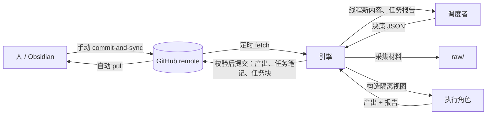

# work_sheet 设计文档

状态：第三稿（2026-11-13）。本稿以 [user-stories.md](user-stories.md) 为准绳重排：先讲工作流和知识库，再讲支撑它们的 harness。第 14 节是故事到设计的对照表，第 15 节是待确认项，第 16 节是参考来源。

## 1. 定位

这不是一个通用的 super agent。它服务两条具体的工作流：

- **知识积累**：看到好材料 → 收进知识库 → 与已有知识和"我们的做法"对照 → 按需扩展研究（故事 K0–K6）。
- **项目跟进**：交入 PRD、进度报告、会议纪要 → 维护一份最新可信的项目现状 → 按需生成汇报（故事 P1–P4）。

harness（调度、角色、隔离、看板）是实现这两条工作流的手段。人只在 Obsidian 里操作；长期以 GitHub 为中心扩展到多个仓库和多个运行环境。

v0 不做：向量检索、Web UI、自动重试、多机协同、后台常驻、操作系统级沙箱、PPT 等特定格式的导出。

## 2. 交互模型

对应故事 G1–G4，是所有故事共用的操作方式。

1. 人在 `inbox/` 新建一页，用自然语言写要求，材料以 URL、拖入的附件或本机路径给出。**不需要写 `@`**；想指定角色时才写 `@角色`。
2. 人执行 obsidian-git 的 "Commit-and-sync"。**提交即发送**，没同步前系统什么都看不到。
3. 系统在该页追加**任务块**，并随进度原地更新：

```markdown
> [!task] [[T-20261113-001]] · librarian · done
> 已收录《文章标题》。新建 [[某来源摘要]]、[[概念 A]]；更新 [[概念 B]]。
```

4. 人在任务块下面继续写追问、修改意见或回答，再同步。**一页 inbox 就是一个线程**，线程内的后续任务能看到之前的要求和产出。
5. 系统需要澄清时，任务进入 `blocked`，问题写在任务块里。
6. 看板显示所有任务；拖卡片可以取消或重跑（第 8 节）。

任务块归引擎所有，人不需要改它；除任务块外，引擎和角色不改 `inbox/` 页里人写的内容。

## 3. 架构总览

| 组成 | 职责 |
|---|---|
| **引擎**（本项目代码） | 唯一执行 git、唯一写任务状态和任务块、唯一启动进程；负责采集材料、构造隔离视图、校验并导入产出。全部是确定性代码 |
| **调度者** `dispatcher` | 小模型。读线程里的新内容和任务报告，输出决策：要采集什么、登记什么任务、交给谁、简报怎么写 |
| **执行角色** | 强模型。每个任务一次全新运行，只看到被授权的文件，产出 Markdown 和一份报告 |
| **任务笔记** `tasks/T-*.md` | 任务状态的唯一事实来源 |

分工借鉴 DeepSeek `dsh-superagent-prototype`（Router / Executor / Ticket / Engine）。不同之处：状态全部放在 git 仓库的 Markdown 里而不是 SQLite；调度者不保留长会话，每次从线程页和任务记录重新读取上下文；隔离由代码构造的目录视图实现，而不是 prompt 约定。



### 一轮巡检

1. `git fetch`，取游标之后的人的提交（引擎自己的提交带 `Task:` trailer，跳过）。
2. 收集事件：线程页里人新写的内容；人对任务状态的改动（拖卡片）；上一轮结束的任务报告。
3. 有事件就调用调度者，得到决策。
4. 执行决策：采集材料 → 创建任务笔记 → 写任务块 → 提交推送。
5. 取 `ready` 的任务逐个运行：改 `running` → 构造视图 → 启动 runner → 校验并导入产出 → 改终态、更新任务块 → 提交推送。
6. 游标前移。

## 4. vault 结构

```
inbox/                 人的入口，一页一个线程
  attachments/         拖进来的文件（Obsidian 附件目录）
raw/                   原始来源存档，只增不改
  2026/11/2026-11-13-<slug>/
    source.md          转换后的 Markdown，frontmatter 记来源和 sha256
    original.pdf       原件（有的话）
wiki/                  外部知识，系统维护
  sources/             每个来源一页摘要
  concepts/  entities/
  index.md             总目录，指向各子目录的 _index.md
  log.md               只追加的操作日志
practice/              "我们的做法"，归人所有
proposals/             系统对 practice/ 的修改建议
projects/
  _index.md            项目名册：名称、别名、一句话说明
  <slug>/
    status.md          项目现状，每次更新整页重写
    log.md             只追加的项目日志
    decisions/         决策记录，一项一页
    reports/           汇报文档
work/<任务 id>/        角色的过程文档（如 researcher 的搜集记录）
outputs/               不属于某个项目的交付物（综述、长答案）
tasks/                 任务笔记；board.base 是看板
assets/                图片
```

目录表示内容种类和**所有权**；进度只由任务笔记的 `status` 表示，不靠挪文件。

## 5. 知识库设计

调研结论：LLM wiki 模式适合"外部知识"（K1、K3、K6），不需要替换；但它不适合直接承载另外两类内容——"我们的做法"需要人的所有权，项目记录是随时间变化的状态而不是概念。所以知识库分三个区，各有不同的写入规则。实践者报告的主要失败模式（近重复页、过时说法悄悄残留、编译后丢细节、状态页不更新）在下面各有对应措施。

### 5.1 三个区

| 区 | 内容 | 谁能写 | 更新方式 |
|---|---|---|---|
| `wiki/` | 世界上怎么说：来源摘要、概念、实体 | librarian | 直接改；每条内容带来源 |
| `practice/` + `proposals/` | 我们怎么做 | `practice/` 归人；系统只写 `proposals/` | 系统提建议，人采纳后才落笔 |
| `projects/<slug>/` | 某个项目现在怎样、怎么变成这样的 | tracker | `status.md` 整页重写，`log.md` 只追加 |

所有区共用同一个底层：`raw/` 里的不可变来源。任何一条知识或项目事实都要能追到 `raw/` 里的某份材料，或追到人在线程里写的话。

### 5.2 原始来源与采集

采集是引擎的一个确定性步骤，不是 agent：调度者的决策里列出要采集的 URL 或路径，引擎转换并存档，之后角色只面对 Markdown。

- 公开网页：用 defuddle（Obsidian Web Clipper 的提取库）转 Markdown。
- 本机文件（PDF / DOCX / PPTX / XLSX / HTML）：用 markitdown 转 Markdown，原件一并存入。
- 存档位置 `raw/YYYY/MM/<日期>-<slug>/`，`source.md` 的 frontmatter：

```yaml
title: 文章标题
source: https://…            # 或原始文件路径
doc_date: 2026-11-10         # 材料自身的日期，能确定时填写
captured: 2026-11-13T18:02
sha256: …                    # 原件（无原件时为 source.md 正文）的哈希
```

- 同一 sha256 的材料不重复存档。
- **采集失败不猜测内容**（K5）：需要登录、反爬、JS 渲染、格式不支持时，任务转 `blocked`，任务块里写明哪份材料、为什么失败、建议怎么提供。上述工具都不渲染 JS，这类页面在 v0 走"下载后拖进来"。
- researcher 联网找到的资料同样只交出 URL，由引擎采集——保证 `raw/` 里是原文而不是模型的转述。
- 采集器是可替换的一步。将来在办公环境通过 MCP 取内部文档时，增加一种采集方式，产出同样格式的 `raw/` 条目，下游不变。

### 5.3 `wiki/`：外部知识

页面类型与 frontmatter：

```yaml
type: source | concept | entity
sources: ["[[某来源摘要]]"]     # concept / entity 页必填
updated: 2026-11-13
status: fresh | stale           # lint 发现来源被更新或被取代时标 stale
```

规则：

- **一个概念或实体只有一页，文件名就是它的名字**，也就是 wikilink 的文本。librarian 新建页面前必须先查目录和搜索同义名；别名记在 frontmatter 的 `aliases` 里。这是针对"近重复页"的措施。
- **段落级引用**：每段陈述后面跟来源页链接；模型自己的归纳标注"（推断）"。
- **改写而非追加**：新材料改变了某个说法时，重写相应段落并保留新旧两个来源，不在页尾堆"更新"小节。来源之间有分歧时并列呈现、注明出处（K3）。
- **来源摘要页**（`wiki/sources/`）每份材料一页：核心观点、对我们有用的部分、指向 `raw/` 的链接。先写它，再去更新概念和实体页。
- **目录分片**：`wiki/index.md` 只列各子目录的 `_index.md`；子目录索引每页一行（链接 + 一句摘要）。单个 index 文件在几百页后会超出上下文预算，所以从一开始就分片。
- `wiki/log.md` 每次操作追加一条：`## [2026-11-13] ingest | 文章标题`，下列新建和修改的页面（G4）。

### 5.4 `practice/` 与 `proposals/`：我们的做法

- `practice/*.md` 的 frontmatter 标 `owner: human`。内容只来自人写的话（K0）或人采纳的建议。
- 系统想改 `practice/` 时，写一页 `proposals/<日期>-<slug>.md`：

```markdown
---
type: proposal
target: "[[某做法]]"
source: "[[某来源摘要]]"
status: proposed            # proposed | accepted | partially-accepted | rejected
---
| # | 文章的主张 | 我们现在的做法 | 差距 | 建议的修改 |
|---|---|---|---|---|
| 1 | …（引原文） | …（引我方文档段落） | … | 把"…"改为"…" |
```

- 人在线程里回复"采纳"或"采纳 1、3"。调度者据此登记落笔任务并为它申请对 `target` 这一个文件的写权限（`grant`）。引擎只在三个条件都满足时才放行：这次调度由人新写的内容触发（不是任务接力）；被授予的路径在该角色的 `grantable` 范围内（librarian 只有 `practice/*.md`）；要修改的文件已存在时，必须附带一页状态为 `proposed` 且 `target` 指向它的建议页。改完后建议页状态更新，被改段落注明来源。
- 人口述一条新的做法（K0）时没有建议页：目标文件尚不存在，授予的是新建这一个文件的权限。
- 没有对应的我方文档时，librarian 如实说明，可据文章起草一页 `practice/` 初稿，同样以建议的形式等人确认。
- 文章与我们的做法一致时，结论就是"无需修改"。

"人没采纳之前我方文档一字不动"不是靠 prompt 保证的：librarian 的写入范围里没有 `practice/`，越界改动在导入时会被引擎拒绝（第 10 节）。

### 5.5 `projects/`：项目记录

项目记录不做成概念页，而是"现状 + 日志 + 决策"三件套。只追加日志而不改现状页，现状就会过时；只改现状页而没有日志，就无法回答"什么时候、为什么变成这样"。两者都要。

`status.md`，每次交入新材料后**整页重写**：

```markdown
---
type: project-status
project: <slug>
as_of: 2026-11-12            # 所依据的最新材料的日期
health: green | yellow | red
sources: ["[[…]]"]
---
## 概要
## 里程碑        （表格：里程碑 | 原计划 | 当前预计 | 变更说明）
## 进展
## Blocker       （每条：内容、出现日期、负责人、来源）
## 决策          （链接到 decisions/）
## 行动项        （- [ ] 事项 · 负责人 · 📅 期限；材料没写的标"未指定"）
## 风险
## 待裁决的不一致
```

`log.md` 只追加，每条按材料日期记：交入了什么、带来哪些变化、依据哪份来源。Blocker 解决后从 `status.md` 移出，在日志里留下"何时出现、何时解决、依据什么"。

`decisions/NNNN-<slug>.md` 一项决策一页（MADR 的精简版）：背景、决定、状态。决策被推翻时不删除，标 `superseded by [[NNNN-…]]`。

**不一致的处理规则**（P3）：

- 新材料的日期晚于 `as_of`：以新材料为准更新现状，并在日志里记"原为 X，现为 Y，依据某材料"。
- 新材料的日期早于 `as_of`，或日期相近的两份材料互相矛盾：不覆盖，写进"待裁决的不一致"，任务块里向人提问。

`projects/_index.md` 是项目名册（名称、别名、一句话说明），调度者靠它判断材料属于哪个项目。遇到不认识的项目名，调度者提问而不是自行新建（P1）。

### 5.6 操作与故事的对应

| 操作 | 做什么 | 角色 | 故事 |
|---|---|---|---|
| 采集 | URL / 文件 → `raw/` | 引擎 | K1 K4 K5 P2 |
| 收录 | 来源 → 来源摘要页 → 更新概念、实体、目录、日志 | librarian | K1 K4 |
| 对照 | 来源 vs `practice/` → 建议页；采纳后落笔 | librarian | K0 K2 |
| 扩展 | 围绕一个方向联网搜集 → 交出 URL 清单和取舍说明 → 采集 → 收录 | researcher → 引擎 → librarian | K3 |
| 项目更新 | 来源 → 重写 `status.md`、追加 `log.md`、记录决策 | tracker | P1 P2 P3 |
| 汇报 | 现状 + 上次汇报以来的日志 → Markdown 汇报 | writer | P4 |
| 问答 | 查知识库和项目记录作答，带引用；没有依据就说没有 | writer | K6 |
| 检查 | 断链、引用的来源不存在、重名页、frontmatter 缺失 | 引擎（脚本） | G4 |

### 5.7 检索

v0 不引入搜索服务。角色按这个顺序找内容：读目录（`index.md` → 子目录 `_index.md`）→ 打开选中的页 → 沿 wikilink 走两三跳 → 用 grep 补充关键词搜索。需要细节时允许回读 `raw/` 的原文，因为编译出来的页面必然丢细节。

汇报和项目问答不需要搜索：直接读该项目的 `status.md`、相关时段的 `log.md` 和它们引用的来源。

推迟：本地混合检索（如 qmd）等到 wiki 超过约 300 页或目录超出上下文预算时再加，届时要先实测它对中文的分词效果；向量检索、热缓存、去重合并任务、图数据库都不在近期范围。线程里积累的真实提问（K6）将来可以直接当作检索评测集。

### 5.8 质量保障

- **单一写入者**：每个区只有一个角色能写（5.1）。
- **导入时的机械检查**（引擎代码，不靠模型自觉）：写入范围、`raw/` 不可改、wikilink 能解析、`sources` 指向的页面存在、新建页不与已有页或别名重名、必填 frontmatter 齐全。不通过则任务判 `failed`，产出不导入，原因写进任务块。
- **不覆盖人的改动**：导入时若目标文件在 `main` 上已被改过，任务转 `blocked`。
- **每个任务一次独立提交**，可单独回退（G4）。

## 6. 调度

调度者处理所有事件。它的输入由引擎拼装、有长度上限：

- 触发本次调度的线程页全文，标出哪部分是人新写的；
- 该线程已有任务的摘要和报告；
- `projects/_index.md`、角色目录（id + 一句话职责 + 适用场景）、`config/routing.md`（人写的路由规则）。

输出：

```json
{"decisions": [
  {"thread": "inbox/2026-11-13 一篇好文章.md",
   "action": "register",
   "capture": ["https://example.com/article"],
   "tasks": [
     {"role": "librarian", "op": "ingest",
      "title": "收录《…》",
      "brief": "……（≤1500 字：目标、产出、边界）",
      "context": ["<本次采集的条目>"]}
   ],
   "reason": "用户要求整合进知识库"}
]}
```

- `action` 三种：`register`、`ignore`、`ask_human`（生成 `blocked` 任务，问题写进任务块）。
- 一次可以登记多个互不依赖的任务（K4：知识类材料每份一个）。同一个项目的多份材料登记成一个 `tracker` 任务，由它按材料日期依次处理，因为每份材料都要在前一份更新后的现状上继续改。
- 追问登记的任务带 `parent`，指向它所延续的任务（G2）。
- **多步工作不预先排计划，靠报告接力**：任务结束时的报告若带有 `handoff` 或 `capture`，就成为一次调度事件；调度者重读线程里的原始要求和已完成的任务，决定是否需要下一步。同一轮巡检内会循环"调度接力 → 运行就绪任务"直到没有新任务，所以一条链在一次 `tick` 里走完。例如 K3：调度者先登记 librarian（收录用户给的文章）和 researcher（围绕指定方向搜集）→ researcher 的报告交出 URL 清单 → 调度者登记 librarian 收录这一批（引擎先采集）。
- 接力登记的任务可以设 `capture_mode: any`：researcher 找到的来源里总有一些抓不下来，这时只要有一份采集成功任务就继续，失败的列在简报和任务块里。用户亲自给的材料仍是默认的"任何一份失败就暂停"。
- 写权限的授予（`grant`）只能出现在由用户亲笔内容触发的调度里，接力调度不能授予（5.4）。
- 引擎校验决策（角色存在、`context` 在该角色可见范围内、字数上限），不合法时带错误信息重问一次，仍不合法转 `blocked`。
- 人新写的每段内容都必须得到一条决策，不允许悄悄漏掉。
- 成本上限：每个线程的任务数上限（默认 8）、接力深度上限（默认 5），超限转 `blocked` 请人放行。

### 任务报告

每个角色结束前在运行目录写 `_report.md`：

```markdown
---
status: done                 # done | failed | blocked
outputs: [wiki/sources/某来源摘要.md, wiki/concepts/概念 A.md]
capture: []                  # researcher：请引擎采集的 URL
handoff:                     # 可选：建议的下一步
  - role: librarian
    reason: 已找到 6 份相关资料，可以收录
---
（≤600 字摘要：做了什么、新建和修改了哪些页面；需要人回答的问题写在这里）
```

摘要会被写进任务块。角色之间不在正文里互相 `@`：联网取回的内容会进入文档，正文不能有触发权；下一个角色应该拿到为它写的简报。

## 7. 角色

按上下文边界、写入权限、模型档位切分，不按岗位名称切分。

| 角色 | 一句话职责 | 为什么独立 | runner |
|---|---|---|---|
| `dispatcher` | 读线程和报告，决定采集什么、登记什么任务、简报怎么写 | 调用最频繁，用小模型；唯一看到任务全局 | `small` |
| `librarian` | 维护 `wiki/`；写对 `practice/` 的建议；人采纳后落笔 | `wiki/` 的唯一写入者 | `strong` |
| `tracker` | 维护 `projects/<slug>/` 的现状、日志、决策和项目名册 | 项目区的唯一写入者；每次只看到一个项目 | `strong` |
| `researcher` | 联网搜集资料，交出 URL 清单和取舍说明 | 唯一有联网权限、唯一接触未经采集的外部内容 | `web` |
| `writer` | 基于知识库或项目记录写给人看的东西：汇报、综述、答案 | 只读知识区，不改知识本身 | `strong` |

`librarian` 和 `tracker` 做的事相似（把来源消化成被维护的页面），但写入区域、页面结构和操作规程都不同，而且项目区按项目隔离、将来在办公环境可能要换模型，所以分成两个角色。

后续按需加入的角色（不在 v0）：`verifier`——只拿到产物和验收标准，独立判定汇报里的每条内容是否有依据，用与生成方不同厂商的模型；`planner`——当出现无法靠报告接力完成的大型多步任务时，先产出计划和验收标准。

### 角色文件

放在本项目的 `roles/` 下，一角色一文件：

```markdown
---
id: tracker
description: 把项目材料整理进项目记录，更新现状、日志和决策。交入 PRD、进度报告、会议纪要时使用。
runner: strong
web: false
needs_project: true          # 没有指定 project 的任务不能派给它
read: ["{thread}", "{context}", "projects/_index.md", "projects/{project}/**"]
write: ["projects/_index.md", "projects/{project}/**"]
skills: []
timeout_minutes: 20
---
你是项目记录员……
（角色 prompt：操作规程写在这里，例如 5.5 的重写规则和不一致处理规则）
```

`skills` 是扩展点：将来 PPT 等特定格式的做法以 skill 的形式挂给 `writer`，不改引擎。

## 8. 任务与看板

任务笔记 `tasks/T-20261113-001.md`：

```markdown
---
id: T-20261113-001
title: 收录《…》
status: running
role: librarian
op: ingest
project:
thread: "[[2026-11-13 一篇好文章]]"
parent:
depth: 0
attempts: 1
created: 2026-11-13T18:02
outputs: []
---
## 简报
……
## 记录
- 18:02 登记
- 18:03 派发 → strong（pi / magpie/deepseek/deepseek-v4-pro）
- 18:09 完成
```

状态：

```
ready ──► running ──► done
             ├──► failed    （非零退出、超时、导入检查不通过）
             └──► blocked   （需要人回答或处理）
任何未结束状态 ──► cancelled
```

看板用 Obsidian 核心功能 Bases 的 Kanban 视图，`tasks/board.base` 按 `status` 把任务笔记分列：

```yaml
filters:
  and:
    - file.inFolder("tasks")
views:
  - type: kanban
    name: Board
    groupBy:
      property: note.status
    groupOrder: [ready, running, blocked, failed, done, cancelled]
```

拖卡片就是改那张任务笔记的 `status`，同步后引擎识别为指令：`failed` / `blocked` → `ready` 是重跑（因采集失败而阻塞的任务会先重新采集），任意 → `cancelled` 是取消。引擎每轮开始时先做一次状态校正：发现有任务处于 `running`（被手动拖过去，或上次运行中断）一律标为 `failed`，拖回 `ready` 可重跑；任务块里显示的状态与任务笔记不一致时，以任务笔记为准更新任务块。

没有采用 Kanban 社区插件：它 2024 年 5 月后没有实质更新、已归档待接手，而且整块看板存在一个文件里，任何界面操作都重写整个文件，人和引擎同时改容易冲突。

## 9. runner

角色文件只写 runner 的**逻辑名**（`small` / `strong` / `web`）。逻辑名到具体 CLI 和模型的绑定在 `config/runners.toml`，每个运行环境一份：

| 逻辑名 | 本机绑定 |
|---|---|
| `small` | pi · `magpie/deepseek/deepseek-flash` |
| `strong` | pi · `magpie/deepseek/deepseek-v4-pro` |
| `web` | grok · `grok-4.7`（自带联网搜索；禁用 shell 和子 agent） |

与机器相关的值都不写在入库的文件里，而是由环境变量提供：`config/*.toml` 里用 `${变量名}` 引用，引擎启动时读取项目根目录的 `.env`（不入库，样本见 `.env.sample`）。

| 变量 | 含义 |
|---|---|
| `WORKSHEET_VAULT_REMOTE`、`WORKSHEET_VAULT_BRANCH` | vault 仓库的地址和分支 |
| `WORKSHEET_BOT_NAME`、`WORKSHEET_BOT_EMAIL` | 引擎在 vault 里提交时用的身份 |
| `WORKSHEET_STATE_DIR`、`WORKSHEET_CONFIG_DIR`、`WORKSHEET_ROLES_DIR` | 引擎状态、配置、角色定义所在目录 |
| `WORKSHEET_PI_BIN`、`WORKSHEET_GROK_BIN` | 两个 agent CLI 的可执行文件 |
| `WORKSHEET_SMALL_MODEL`、`WORKSHEET_STRONG_MODEL`、`WORKSHEET_WEB_MODEL` | 三个逻辑 runner 各自使用的模型 |

到办公环境后改 `.env` 即可换模型和 CLI 路径；若要换成调用方式完全不同的 CLI，另备一个配置目录并用 `WORKSHEET_CONFIG_DIR` 指过去。角色定义和 vault 结构都不用动。凭证由各 CLI 自己管理，不写进本项目，也不放进 `.env`。

runner 契约：在指定的视图目录里启动；收到角色 prompt 和"阅读 `_brief.md` 完成任务"的提示；只通过读写视图里的文件工作，结束前写 `_report.md`；不执行 git。退出码 0 且有合法报告为成功。

本机已核实（2026-11-13）：

| 项 | 结果 |
|---|---|
| `pi -p --no-session --no-context-files --no-skills --no-extensions --no-tools --model magpie/deepseek/deepseek-flash "…"` | 实跑成功，约 1.2 秒 |
| `grok -p "…" --output-format json --max-turns 1 --disable-web-search --no-subagents` | 实跑成功，约 4.7 秒，返回含用量的 JSON |
| grok 的环境上下文 | 空目录下仍自动加载 `~/.claude/Claude.md` 和用户级 skills |
| 采集工具 | 本机有 Node 和 `pdftotext`；defuddle、markitdown、pandoc 均未安装 |

尚未核实，列入 M0：两个 CLI 执行带工具的多轮任务的表现；grok 如何关闭全局指令和 skills；defuddle 与 markitdown 对实际材料（含中文）的转换质量。

## 10. 上下文可见性

每个角色能看到什么由角色文件的 `read` 定义，由引擎构造的**隔离视图**落实：每次运行在仓库之外新建一个临时目录，只放入该角色 `read` 允许且本任务用得到的文件，加上 `_brief.md`；不含 `.git`。角色在视图里工作，结束后引擎对比差异并导入，落在 `write` 范围之外的改动使整个任务失败。

| 角色 | 可读 | 可写 |
|---|---|---|
| `dispatcher` | 线程页、线程内任务摘要与报告、项目名册、角色目录、路由规则 | 无（只输出 JSON） |
| `librarian` | 线程页、本任务的 `raw/` 条目、`wiki/**`、`practice/**` | `wiki/**`、`proposals/**`；`practice/` 仅限人已采纳的那一个文件 |
| `tracker` | 线程页、本任务的 `raw/` 条目、项目名册、`projects/{project}/**` | 项目名册、`projects/{project}/**` |
| `researcher` | 线程页、`wiki/index.md` 及简报点名的页面 | `work/{task}/**` |
| `writer` | 线程页、项目名册、`projects/{project}/**`（仅任务所属的项目）、`wiki/**`、`practice/**` | `projects/{project}/reports/**` 或 `outputs/**` |

要点：

- 所有执行角色都看不到 `tasks/`、别的线程、别的角色的简报和运行日志。
- `tracker` 和项目类的 `writer` 每次只看到一个项目。
- 写入范围是硬约束，由导入检查保证，与用哪个 CLI 无关。
- 读取范围在现阶段是"视图里没有"。角色若用绝对路径仍可能读到视图之外，这一点现阶段接受；操作系统级沙箱不排期，等有实际需要（例如办公环境的要求）再做。
- CLI 自带的环境上下文是另一条通道：pi 用 `--no-session --no-context-files --no-skills --no-extensions` 关闭；grok 通过 runner 配置里的环境变量关闭对 Claude / Cursor 指令文件、规则、skills 的加载和跨会话记忆（`GROK_CLAUDE_*_ENABLED=false`、`GROK_MEMORY=0`，已用 `grok inspect` 确认全局指令文件变为 disabled）。grok 自己的用户级 skills 仍会以名称和简介的形式出现在它的上下文里，这一点暂时接受。
- 简报限 1500 字，报告摘要限 600 字；运行日志只留在引擎本机。将来加入 `verifier` 时，它的简报由引擎按模板拼装（只含产物路径和验收标准路径），不经调度者转述，也不给它线程页。

## 11. git 与 Obsidian 配置

- 引擎用自己的 clone（本项目被 gitignore 的 `.state/` 下），不碰人在 Obsidian 里打开的那份 vault 目录，两边只通过 remote 交换。
- 引擎是唯一的写入者：串行导入、提交、`pull --rebase`、推送。提交带 trailer `Task: T-…`、`Role: …`，使用 bot 身份。并发为 1。
- vault 直接推 `main`。
- 启动方式：`uv run worksheet tick` 执行一轮；`uv run worksheet run` 前台循环，Ctrl-C 停止。

Obsidian 侧的调整（直接改配置文件，M0 执行）：

- vault 根目录与 git 根目录一致（`.obsidian/` 位于仓库根）。若建 vault 时多套了一层目录，需在 Obsidian 关闭时把内容上移并更新 Obsidian 的 vault 登记路径。
- obsidian-git（已装 2.43.0，尚无 `data.json`）：`autoSaveInterval: 0`、`autoPushInterval: 0`，`autoPullInterval` 设 1–2 分钟，`autoPullOnBoot: true`，`pullBeforePush: true`。键名已在插件源码里确认。
- 附件目录设为 `inbox/attachments/`；`.gitignore` 加 `.obsidian/workspace*.json`。
- 本机 Obsidian 1.15.1，Bases 已启用，满足看板要求（1.14 起提供）。

## 12. 项目结构

```
work_sheet/
  docs/user-stories.md  docs/design.md
  roles/*.md               角色定义
  .env.sample              本机设置的样本；复制为 .env（不入库）后填写
  config/runners.toml      逻辑名 → CLI 调用方式
  config/workspaces.toml   已注册的工作区（先只有一个 vault）
  config/routing.md        给调度者的路由规则
  src/work_sheet/          引擎（Python 3.13 + uv，直接调 git CLI）
  tests/
  .state/                  gitignore：clone、游标、运行日志
```

## 13. 里程碑

每个里程碑以用户故事的验收条目为准。

**M0 收录一篇文章。** 故事 K1、K5，以及 G3、G4 的基本形态。
- 迁移 vault 根目录，写 Obsidian 配置，建目录骨架和 `board.base`。
- 引擎主循环、采集（URL 和本机文件）、调度者、`librarian` 的收录操作、隔离视图与导入检查、任务笔记与任务块。
- 核实第 9 节的未核实项。
- 验收：inbox 写一页并附 URL → 同步 → `tick` → pull 后看到任务块、`raw/` 存档、来源摘要页、更新的概念页和目录；给一个需要登录的链接，得到 `blocked` 和明确的失败说明。

**M1 项目跟进。** 故事 P1–P4、K4、K6、G1、G2。
- `tracker`、`writer`、项目名册、不一致处理、线程内的追问、看板拖卡指令、`run` 循环。
- 验收：先后交入两份日期不同、内容有出入的项目材料，`status.md` 反映最新情况，`log.md` 记有变化；要求生成汇报，得到带来源清单的 Markdown；提修改意见后得到新版本。

**M2 对照与扩展。** 故事 K0、K2、K3。
- `practice/` 与 `proposals/`、采纳流程和单文件写权限、`researcher` 与报告接力、成本上限。
- 验收：写一段"我们的做法" → 交一篇相关文章要求对照 → 得到建议页；回复"采纳 1" → 只有第 1 条落笔；要求扩展一个方向 → 概念页引用多个已存档的来源。

**M3 之后。** 按需：`verifier` / `planner`；本地检索；通过 skill 支持 PPT 等格式；MCP 采集；多工作区与多引擎（各引擎声明标签，用"推送一条把任务改为 `running` 的提交"认领任务）；按工作区配置 PR 流程；GitHub issue 触发；后台常驻；沙箱。

## 14. 故事到设计的对照

| 故事 | 依赖的设计 | 里程碑 |
|---|---|---|
| K0 积累我们的做法 | 5.4；`librarian` 对 `practice/` 的受限写权限 | M2 |
| K1 收录文章 | 5.2 采集、5.3、5.8；`librarian` | M0 |
| K2 对照升级 | 5.4 建议页与采纳流程；第 10 节写入范围 | M2 |
| K3 扩展研究 | 5.2（researcher 只交 URL）、第 6 节报告接力；`researcher` | M2 |
| K4 多份材料 | 第 6 节一次登记多个任务 | M1 |
| K5 材料拿不到 | 5.2 采集失败规则；`blocked` 状态 | M0 |
| K6 提问 | 5.7 检索；`writer` | M1 |
| P1 建立项目 | 5.5 项目名册；调度者遇到未知项目先问 | M1 |
| P2 更新现状 | 5.5 三件套；`tracker` | M1 |
| P3 不一致 | 5.5 不一致处理规则 | M1 |
| P4 生成汇报 | 5.6 汇报操作；`writer`；`skills` 扩展点 | M1（Markdown） |
| G1 看板 | 第 8 节 | M1 |
| G2 追问 | 第 2 节线程；调度者输入含线程全文 | M1 |
| G3 系统提问 | `ask_human`、`blocked`、任务块 | M0 |
| G4 改了什么 | 任务块摘要、`wiki/log.md`、每任务一次提交 | M0 |

## 15. 待确认

都有默认方案，不回答即按默认执行。

1. **角色之间靠报告接力，而不是在正文末尾 `@` 下一个角色**（第 6 节）。这与你最初的设想不同，默认采用。
2. **`tracker` 与 `librarian` 分成两个角色**（第 7 节）。备选是合并成一个角色、用不同的操作规程，角色更少但项目隔离和将来换模型会麻烦些。
3. **知识页的语言与命名**：正文用中文，技术名词保留原文；概念和实体页的文件名用最通行的叫法（技术名词通常是英文）。

## 16. 参考来源

由调研 subagent 于 2026-11-13 查阅，我未逐条复核原文。

- DeepSeek `deepseek-ai/dsh-superagent-prototype`：Router / Executor / Ticket / Engine 的分工，交接载荷的字数上限，以及它自述的"隔离只是默认值而非安全边界"。
- ByteDance `bytedance/deer-flow` 2.0、Anthropic 工程博客（*Harness design for long-running apps*、*Building multi-agent systems*）、Cognition *Multi-agents: what's actually working*、`obra/superpowers`：全新上下文加书面简报、文件交接、按上下文边界切分角色、写入保持单线、验证方独立。
- Karpathy "LLM wiki" gist 及其评论区；Tuszynski 六个月使用报告（mpt.solutions）；AgentX 复盘（noqta.tn）；`AgriciDaniel/claude-obsidian`、`Ar9av/obsidian-wiki`、`atomicstrata/llm-wiki-compiler`：三层结构、目录与日志、失败模式（近重复页、过时说法残留、丢细节、状态页不更新）及对应做法（一实体一文件、改写而非追加、机械检查、写入前校验哈希、目录先行再沿链接检索）。
- MADR（决策记录与 superseded by）、Graphiti（事实作废而不删除）、Cline Memory Bank（当前状态页加进展页）：项目记录的结构与不一致处理。
- "Is Grep All You Need?"（arXiv 2605.15184）、`tobi/qmd`：检索方案的取舍。
- `kepano/defuddle`、`microsoft/markitdown`、pandoc 文档：采集与导出工具。
- Obsidian Bases Kanban 视图文档、`callumalpass/tasknotes`、`community-archive/obsidian-kanban`：看板方案。
